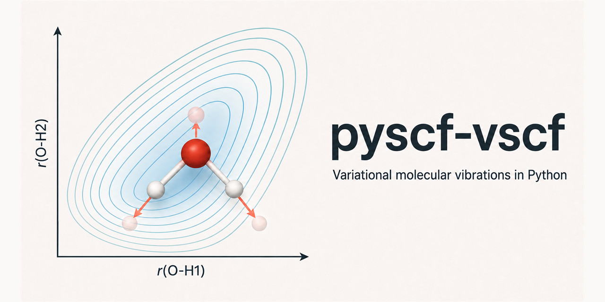

# pyscf-vscf



`pyscf-vscf` computes anharmonic vibrational spectra variationally, on
potential-energy and dipole-moment surfaces evaluated with
[PySCF](https://pyscf.org). It scans one or two bond stretches (or a normal
coordinate), solves the vibrational Schrodinger equation on that grid, and
reports assigned transition frequencies with absolute infrared intensities.
For more coordinates it offers vibrational self-consistent field (VSCF) and
configuration-interaction (VCI) solvers on fitted n-mode surfaces.

It is meant for researchers who need anharmonic frequencies and intensities
of a few strongly anharmonic modes, such as X-H stretches, overtones, and
isotopologues, beyond what harmonic analysis or second-order perturbation
theory provide, and who want every step to be inspectable, cached, and
reproducible from Python.

```bash
pip install pyscf-vscf
```

Python 3.11 or newer; see [installation](installation.md). Upgrading from
0.2? Read the [migration guide](migration-0.3.md).

## Where to start

- [Water O-H stretch spectrum](tutorials/water-stretch.md): optimize, scan,
  and solve from the command line or Python, then reuse the scan for D2O.
- [Water VSCF and VCI from PySCF](tutorials/water-vscf-vci.md): harmonic
  modes, a fitted n-mode surface, and VSCF/VCI fundamentals with intensities.
- [Your own PySCF method](tutorials/custom-method.md): run any PySCF mean
  field through a `MethodRecipe`.
- [Scans, the point store, and parallel runs](scans.md): how scans are
  planned, evaluated, resumed, and how the default grid was chosen.
- The [API reference](api/scans.md), generated from the docstrings.

## What it computes

- 1D and 2D sinc-DVR spectra on frozen local-bond scans, rigid
  normal-coordinate scans, and exactly constrained relaxed normal-coordinate
  scans, with overlap-based state assignments.
- Absolute intensities for light polarized along a bond and for isotropic
  samples, in km/mol and as integrated cross sections.
- State-specific VSCF for n-mode Hamiltonians with one-mode potentials and
  two-mode couplings, with transition moments and intensities.
- Fitted 1MR/2MR and selected 3MR scalar and vector n-mode surfaces, VCI on
  VSCF modals, and a complete triatomic Jacobi `J=0` kinetic-energy operator.
- Harmonic analysis and geometry optimization through PySCF and geomeTRIC,
  with the built-in methods or any PySCF method as a recipe.
- Resumable, parallel evaluation of electronic points with a SQLite point
  store, and checksummed scan files whose identity is independent of isotope
  masses.

The package does not generate full-dimensional potential surfaces and does
not implement a general curvilinear or rovibrational kinetic-energy operator.
Reduced-dimensional results inherit the error of the omitted coordinates.

## Stability

| Area | Modules | Status |
| --- | --- | --- |
| Command line, scans, point store and runner, 1D/2D DVR spectra, method recipes | `cli`, `scans`, `runner`, `point_store`, `contracts`, `variational`, `dvr`, `backends.pyscf` | Stable; changes are announced in the changelog |
| VSCF on n-mode potentials | `vscf` | Stable |
| n-mode surfaces, triatomic `J=0`, VCI, transition moments, multilevel surfaces, correlated providers | `nmode`, `kinetic`, `vci`, `transition_moments`, `multilevel`, `backends.pyscf_correlated` | Evolving; may change between minor releases |

APIs deprecated in 0.3 (the 0.2 tuple scans, schema-3 cache writers, and the
flag-style command line) keep working with a warning and are removed in 0.4.

## Validation

The test suite combines analytic numerical checks, small PySCF calculations,
and archived H2O/HDO/D2O and NH3 molecular validations against exact DVR.
These establish solver correctness and convergence on the stated
reduced-dimensional Hamiltonians; they do not establish general spectroscopic
accuracy.

## Citing and contributing

If you use `pyscf-vscf` in research, cite it with the metadata in
[`CITATION.cff`](https://github.com/diogovalada/pyscf-vscf/blob/main/CITATION.cff)
(GitHub's "Cite this repository" button). Bug reports, questions, and
contributions are welcome; see
[CONTRIBUTING](https://github.com/diogovalada/pyscf-vscf/blob/main/CONTRIBUTING.md)
and the [changelog](https://github.com/diogovalada/pyscf-vscf/blob/main/CHANGELOG.md).
